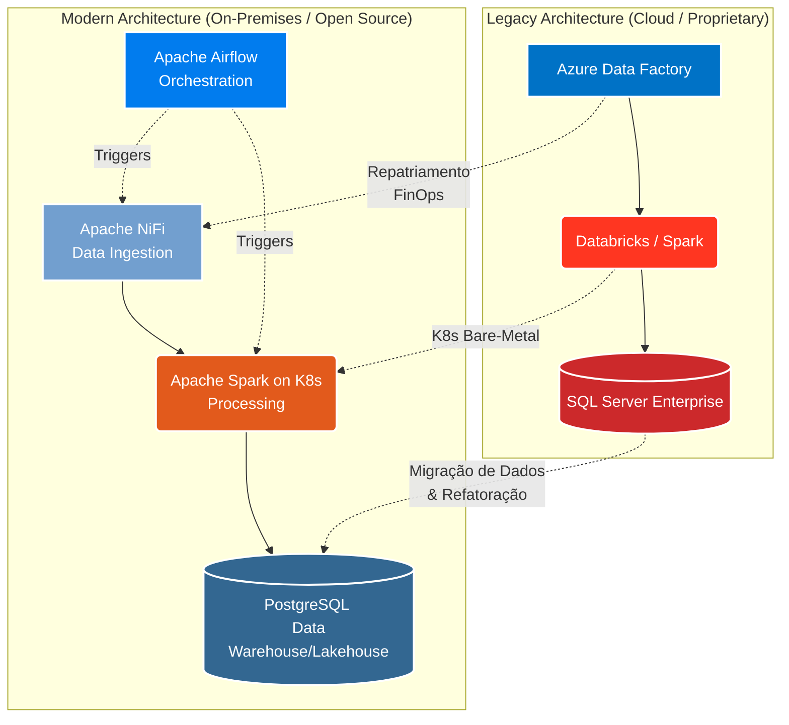

<h1 align="center">Cleidson Jardim 🚀</h1>
<h3 align="center">Consultor em Arquitetura de Dados & Infraestrutura Big Data | Especialista Bare-Metal</h3>

  
  

---

## 👨‍💻 Visão Executiva

Especialista e Arquiteto de Dados com **mais de 18 anos de trajetória** na área de Tecnologia da Informação. Meu foco principal é o desenho, implementação e otimização de infraestruturas de dados de alta complexidade e performance. Minha atuação é o ponto de intersecção entre a **Engenharia de Dados Moderna**, o rigor do **FinOps** e a execução estratégica de **Cloud Repatriation** (Repatriamento de Nuvem).

* 🏗️ **Foco Atual:** Liderança na migração estratégica de stacks de Engenharia de Dados do Azure para infraestrutura On-Premises de alta disponibilidade, totalmente baseada em **Kubernetes (K8s) Bare-Metal** e ecossistema Open Source.
* 🎓 **Formação Acadêmica:** Graduação em Banco de Dados e Pós-Graduação em Big Data Analytics.
* 🎯 **Missão:** Gerar eficiências financeiras milionárias para o negócio sem comprometer escalabilidade, resiliência ou segurança.

---

## 🏆 Destaques de Impacto & FinOps (+R$ 4.4M de Economia)

Minha abordagem de arquitetura é orientada a valor (Value-Driven). Ao longo da minha carreira, acumulei **+R$ 4,4 Milhões em economia total** gerada diretamente por otimização de recursos e substituição de ferramentas proprietárias por soluções Open Source Enterprise-Grade.

* 📉 **Redução de R$ 2,4 Milhões (Cloud Costs):** Arquitetura e migração de pipelines legados em Azure Data Factory (ADF) e Databricks para um ambiente Open Source robusto (Apache Spark, Airflow e NiFi) rodando sobre Kubernetes Bare-Metal.
* 💰 **Economia de R$ 2,0 Milhões (Licenciamento):** Condução de projetos de migração de clusters SQL Server para PostgreSQL, eliminando o *vendor lock-in* e custos recorrentes de licenças de SGBD e Sistemas Operacionais.

---

## 🏛️ Arquitetura: Cloud Repatriation & Modernização

O diagrama abaixo ilustra o meu case principal de transformação arquitetural, movendo workloads caros de nuvem pública para uma infraestrutura Bare-Metal ultra-otimizada:

---

## 🛠️ Stack Tecnológica & Especialidades Detalhadas

Minhas decisões tecnológicas são pautadas na tríade: **Performance, Escalabilidade e TCO (Total Cost of Ownership)**.

### ☸️ Infraestrutura & Orquestração de Containers
*  **Kubernetes (K8s) Bare-Metal:** Desenho de clusters K8s altamente disponíveis diretamente no hardware físico (On-Premises). Eliminação de hypervisors para extrair a performance máxima de I/O e CPU necessária para workloads de Big Data.
*  **Containerização:** Padronização de ambientes de execução para garantir que o código funcione de forma idêntica do desenvolvimento à produção.

### ⚙️ Engenharia & Processamento de Dados
*  **Apache Spark:** Motor de processamento distribuído utilizado para rotinas pesadas de ETL/ELT. Experiência na configuração do Spark rodando nativamente sobre Kubernetes, otimizando alocação de executores e memória.
*  **Apache Airflow:** Orquestração centralizada de pipelines de dados. Criação de DAGs complexas, controle de dependências, SLAs e alertas corporativos. Substituição direta do Azure Data Factory.
*  **Apache NiFi:** Roteamento dinâmico e ingestão de dados em tempo real. Essencial para desacoplar sistemas de origem e gerenciar backpressure em arquiteturas de alta volumetria.
*  /  **Legacy Cloud/PaaS:** Profundo conhecimento em Azure Cloud (ADF, Databricks, Synapse) para arquitetar a desconstrução e migração reversa segura (Repatriamento).

### 🗄️ Bancos de Dados, Migrações & Modelagem
*  **PostgreSQL:** Escolha primária para consolidação de dados relacionais e Data Warehouses operacionais. Especialista em Tuning avançado de queries, configuração de buffers, replicação lógica/física e otimização de I/O.
*  **SQL Server:** Administração avançada, modelagem e liderança de projetos de descontinuação (migração homogênea e heterogênea) visando economia de licenciamento.
* 📐 **Modelagem & Tuning:** Desenho de esquemas (Star/Snowflake), normalização/desnormalização estratégica e troubleshooting de performance em alto volume transacional e analítico.

---

## 📈 Atividade no GitHub

  
  

---

  <i>"A verdadeira arquitetura não resolve apenas problemas técnicos, mas otimiza a sustentabilidade financeira do negócio."</i>

